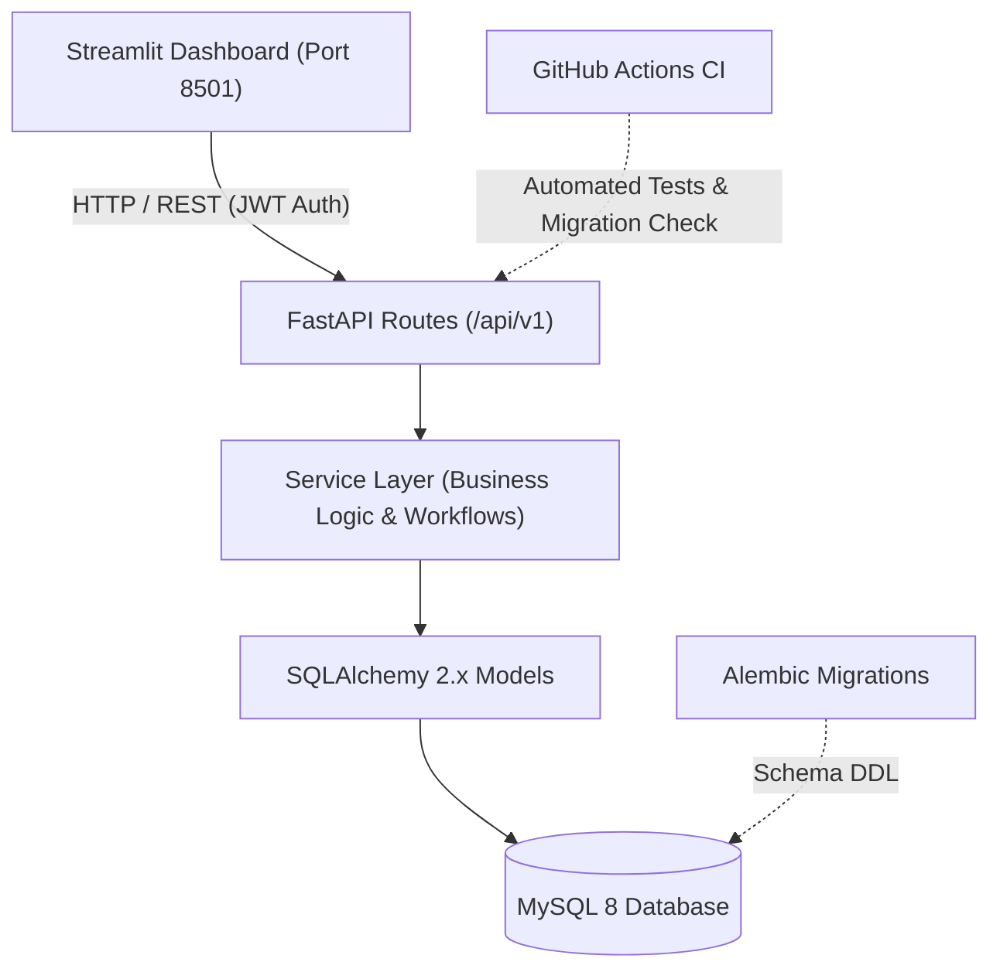
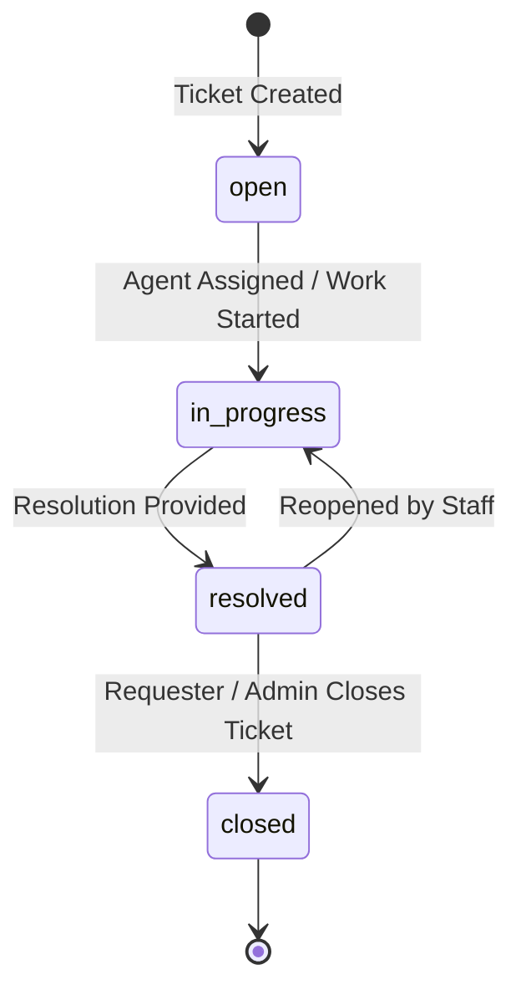
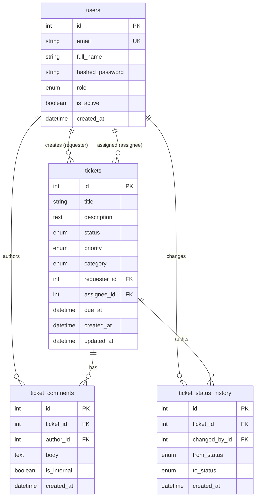

# HelpDesk API

Role-based IT helpdesk ticketing REST API with SLA tracking, SQL reports and a Streamlit dashboard.

[](https://github.com/pasupunuri-pragnitha/HelpDesk-API/actions/workflows/ci.yml)


---

## Contents

- [Features](#features)
- [Architecture](#architecture)
- [Ticket Workflow](#ticket-workflow)
- [Database Schema](#database-schema)
- [API Overview](#api-overview)
- [Quick Start](#quick-start)
- [Testing & Quality](#testing--quality)
- [Design Decisions](#design-decisions)
- [Known Limitations](#known-limitations)
- [Roadmap](#roadmap)
- [Project Structure](#project-structure)
- [Author](#author)

---

## Features

| Capability | Description |
| :--- | :--- |
| **Authentication & Roles** | JWT authentication with bcrypt hashing (72-byte limit validation). Three roles: `requester`, `agent`, and `admin`. |
| **Ticket Workflow** | Enforced state transitions (`open` -> `in_progress` -> `resolved` -> `closed`, with reopen). Invalid moves return 409. |
| **SLA Tracking** | Automatic `due_at` calculation by priority (Urgent: 2h, High: 8h, Medium: 24h, Low: 72h) with overdue detection. |
| **Comments & History** | Public comments and staff-only `is_internal` notes. Full status change audit history recorded on state changes. |
| **Search & Pagination** | Sanitized keyword search (`q`), multi-criteria filtering, multi-field sorting, and offset pagination. |
| **SQL Reports** | Raw SQL reports using aggregations, `LEFT JOIN`, Common Table Expressions (CTEs), and `RANK()` window functions. |

---

## Architecture

The system uses a layered architecture separating transport, business logic, persistence, and presentation.



---

## Ticket Workflow

The ticket lifecycle follows an explicit state transition machine managed entirely in the service layer.



Any invalid or out-of-order state transition is rejected with an HTTP 409 Conflict status.

---

## Database Schema



---

## API Overview

All routes are prefixed with `/api/v1`. Interactive documentation is available at `/docs` (Swagger UI) and `/redoc` (ReDoc).

| Method | Endpoint | Description | Access |
| :--- | :--- | :--- | :--- |
| `POST` | `/api/v1/auth/register` | Register a new user account (defaults to requester role) | Public |
| `POST` | `/api/v1/auth/login` | Authenticate with email and password, returning JWT | Public |
| `GET` | `/api/v1/users/me` | Retrieve profile of the currently authenticated user | Authenticated |
| `GET` | `/api/v1/users` | List registered users with pagination parameters | Admin |
| `PATCH` | `/api/v1/users/{id}/role` | Update role of a specific user | Admin |
| `POST` | `/api/v1/tickets` | Create a new support ticket (optional category, default `other`) | Authenticated |
| `GET` | `/api/v1/tickets` | List tickets with filters (status, priority, category, assignee, overdue), search, and pagination | Authenticated |
| `GET` | `/api/v1/tickets/{id}` | Get ticket details (returns 404 if accessed by foreign requester) | Authenticated |
| `PATCH` | `/api/v1/tickets/{id}` | Update title, description, priority, or category | Owner (open) / Agent (category) / Admin |
| `PATCH` | `/api/v1/tickets/{id}/status` | Transition ticket status | Agent / Admin |
| `PATCH` | `/api/v1/tickets/{id}/assign` | Assign ticket to an agent (transitions open -> in_progress) | Agent / Admin |
| `POST` | `/api/v1/tickets/{id}/comments` | Add comment (staff can set `is_internal=true`) | Owner / Agent / Admin |
| `GET` | `/api/v1/tickets/{id}/comments` | List ticket comments (internal notes hidden from requesters) | Owner / Agent / Admin |
| `GET` | `/api/v1/tickets/{id}/history` | Retrieve full status transition history audit trail | Owner / Agent / Admin |
| `GET` | `/api/v1/reports/tickets-by-status` | Aggregated ticket counts grouped by status and priority | Agent / Admin |
| `GET` | `/api/v1/reports/overdue` | List overdue tickets past SLA due date with requester and assignee | Agent / Admin |
| `GET` | `/api/v1/reports/resolution-time` | Average resolution hours per agent calculated via CTE | Agent / Admin |
| `GET` | `/api/v1/reports/agent-ranking` | Agent performance ranking calculated via `RANK()` function | Agent / Admin |
| `GET` | `/api/v1/reports/daily-volume` | Daily creation volume over a configurable window (1–90 days) | Agent / Admin |
| `GET` | `/api/v1/reports/sla-breach-rate` | SLA breach rate and compliance counts per ticket priority | Agent / Admin |
| `GET` | `/api/v1/reports/resolution-time-by-category` | Average resolution hours grouped by category and priority | Agent / Admin |
| `GET` | `/api/v1/reports/agent-workload` | Agent workload summary: open work, overdue tickets, and resolved counts | Agent / Admin |
| `GET` | `/api/v1/reports/tickets-by-category` | Ticket counts grouped by category, optionally broken down by status | Agent / Admin |
| `GET` | `/api/v1/health` | Health check endpoint confirming API and database connectivity | Public |

---

## Quick Start

Follow these steps to run the API and Streamlit dashboard locally on Windows PowerShell.

### 1. Clone the repository
```powershell
git clone https://github.com/pasupunuri-pragnitha/HelpDesk-API.git
cd HelpDesk-API
```

### 2. Create and activate a virtual environment
```powershell
python -m venv .venv
.venv\Scripts\Activate.ps1
```

### 3. Install dependencies
```powershell
pip install -r requirements.txt -r requirements-dev.txt
pip install -r dashboard/requirements.txt
```

### 4. Configure environment variables
```powershell
Copy-Item .env.example .env
```

### 5. Start MySQL database container
```powershell
docker compose up -d db
```

### 6. Run database migrations
```powershell
alembic upgrade head
```

### 7. Create an initial administrator account
```powershell
python -m app.scripts.create_admin --email admin@example.com --password <your-password> --name "System Admin"
```

### 8. Run the FastAPI backend
```powershell
uvicorn app.main:app --reload --port 8000
```

### 9. Run the Streamlit dashboard
In a separate PowerShell terminal:
```powershell
streamlit run dashboard/app.py
```
For dashboard details, see [dashboard/README.md](dashboard/README.md).

---

## Testing & Quality

| Metric | Value |
| :--- | :--- |
| **Pytest Tests** | 95 passed, 1 skipped (96 collected) |
| **Code Coverage** | 96% (`app`) |
| **Database Migrations** | 5 Alembic migrations |
| **User Roles** | 3 (`requester`, `agent`, `admin`) |
| **SQL Reports** | 9 raw SQL reports |

Run the test suite locally with coverage reporting:
```powershell
pytest --cov=app --cov-report=term-missing --cov-fail-under=85
```

GitHub Actions CI runs the full test suite with coverage enforcement and executes MySQL 8 migration checks (`upgrade -> downgrade -> upgrade`) on every push and pull request.

---

## Design Decisions

- **404 Instead of 403 for Foreign Tickets**: Requesters attempting to view another user's ticket receive a 404 Not Found rather than 403 Forbidden to prevent ticket ID enumeration.
- **Requester Identity Bound to JWT**: The `requester_id` is always extracted from the authenticated user token, preventing users from creating tickets on behalf of others.
- **Service-Layer State Machine**: Status transitions are defined centrally in `app/services/tickets.py` rather than within routes, guaranteeing uniform business rule enforcement.
- **Bcrypt 72-Byte Limit Validation**: Pydantic validators explicitly check the UTF-8 byte length (maximum 72 bytes) before passing passwords to bcrypt, avoiding silent password truncation.
- **Dual-Engine Test Strategy**: Local unit tests run against fast in-memory SQLite (`sqlite:///:memory:`) for sub-second execution, while CI executes against MySQL 8 to validate SQL window functions and migrations (which caught a real MySQL-only downgrade bug in migration 0002).
- **Correlation Request-ID Logging**: Middleware extracts or generates an `X-Request-ID` stored in `contextvars`, including it in all log entries across the request lifecycle without logging sensitive tokens or passwords.

---

## Known Limitations

- **Calendar-Hour SLAs**: SLA due dates are calculated using continuous calendar hours rather than business hours or holiday calendars.
- **Offset Pagination**: Pagination uses standard SQL `LIMIT` / `OFFSET`, which is straightforward for moderate datasets but less performant on massive tables than keyset pagination.
- **User Roster Access**: Only admins can list users; agents must input target agent IDs manually when assigning tickets.
- **No Email Notifications**: Ticket lifecycle events and comments are tracked in database history rather than sending outbound email alerts.

---

## Roadmap

- [ ] Business-hours SLA calculation with holiday calendar support
- [ ] Keyset/cursor-based pagination for high-volume ticket archives
- [ ] Email notifications via SMTP/SendGrid on status and comment events
- [ ] File and image attachment uploads for tickets and comments

---

## Project Structure

```text
.
├── alembic/              # Database migration configuration and version scripts
├── app/                  # FastAPI backend application core, models, schemas, and routes
│   ├── api/              # API route definitions and dependency injection
│   ├── core/             # Configuration, logging middleware, security, and SLA definitions
│   ├── db/               # Database engine, session management, and Base declarative model
│   ├── models/           # SQLAlchemy entity models and enums
│   ├── schemas/          # Pydantic models for validation and response serialization
│   ├── scripts/          # Administrative CLI utilities (admin user creation)
│   └── services/         # Business logic layer (tickets workflow, reports, auth)
├── dashboard/            # Streamlit web portal client and analytics views
├── docs/                 # Documentation assets
├── tests/                # Automated pytest test suites and client mocks
├── docker-compose.yml    # Multi-container orchestration for MySQL 8 and backend
├── Dockerfile            # Container build specification for FastAPI app
├── pytest.ini            # Pytest configuration and coverage settings
├── requirements.txt      # Production runtime dependencies
└── requirements-dev.txt  # Development and testing dependencies
```

---

## Author

**Pasupunuri Pragnitha**  
- GitHub: [pasupunuri-pragnitha](https://github.com/pasupunuri-pragnitha)  
- LinkedIn: [pragnitha-pasupunuri](https://www.linkedin.com/in/pragnitha-pasupunuri)
